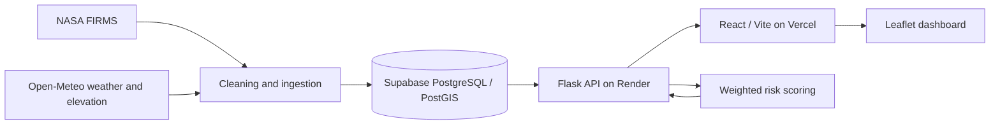

# EmberWatch — Wildfire Early Detection & Risk Monitoring

**Team Ash Detectives · ECE444 Software Engineering · University of Toronto**

[Live dashboard](https://ember-watch-xi.vercel.app/) · [Issues](https://github.com/RianaMalhotra/EmberWatch/issues) · [Project board](https://github.com/users/RianaMalhotra/projects/1) · [Contributing](CONTRIBUTING.md)

> **Educational prototype, not an emergency alert service.** EmberWatch displays satellite-derived detections and experimental environmental risk estimates. Data can be delayed, incomplete, or inaccurate; do not use it for evacuation, firefighting, or other safety-critical decisions.

## Overview

EmberWatch is a deployed React/Leaflet dashboard backed by a Flask API and Supabase PostgreSQL/PostGIS. It helps users explore monitored Canadian locations, historical and recent NASA FIRMS fire detections, environmental observations, and explainable area-level wildfire risk. **Detection confidence** (certainty associated with a satellite hotspot) and **risk** (a weighted estimate for a geographic area) are different quantities.

## Current functionality

| Feature | Implementation and limitations |
| --- | --- |
| Interactive dashboard | React/Vite and Leaflet map with selectable monitored areas, detection markers, area details, and loading/empty/error states. |
| Database-backed area risk | `GET /api/risk-areas` loads monitored areas and environmental inputs from Supabase and computes risk scores. It does **not** return the original three hard-coded mock areas. Unavailable database data produces an error rather than invented observations. |
| Risk zones (#44) | Optional **50 km circular risk-zone overlay** shaded by computed risk; dashed outlines distinguish incomplete assessments. These are model footprints, **not** a continuous interpolated heatmap or fire-spread prediction. |
| Explainable risk (#21, #45, #57) | Weighted 0–100 risk score, LOW/MODERATE/HIGH classification, factor scores, missing inputs, coverage, and model version (`weighted-index-v1`). Area detail exposes contributing environmental factors. |
| Satellite detections (#43, #46) | `GET /api/detections` returns classified database-backed FIRMS observations, timestamps, confidence, and data gaps. `GET /api/detections/history` supports validated geographic and UTC time filters. |
| Data ingestion and freshness (#93, #94) | Scripts and GitHub Actions workflows for Open-Meteo weather refresh and recent NASA FIRMS ingestion. The UI indicates stale observations; scheduled workflows and external feeds can fail and must be verified in deployment. |
| Reliability and contracts (#50, #63) | JSON API errors, degraded/incomplete states, retry behavior, client response-contract tests, and backend tests with an 80% coverage gate. |
| Historical model validation (#57) | Reproducible comparison of seven selected wildfire events against prior-year and winter dates. Fire days scored higher in all seven cases, but only one reached HIGH. This small, selected sample **does not establish accuracy or calibration**. |

**Not yet merged into `main` (as of November 14, 2026):** PR [#100](https://github.com/RianaMalhotra/EmberWatch/pull/100) proposes further external-data and processing-failure hardening; PR [#101](https://github.com/RianaMalhotra/EmberWatch/pull/101) proposes a public fire-report submission backend. Do not treat their features as released until those PRs merge and required database migrations/deployment configuration are applied. See the [pull requests](https://github.com/RianaMalhotra/EmberWatch/pulls) for live status.

## Risk model and data provenance

The `weighted-index-v1` model combines temperature (15%), relative humidity (20%), wind (15%), precipitation (10%), vegetation/NDVI (10%), terrain slope (5%), and nearby historical detections (25%). Scores are computed from available inputs, with weights renormalized. If available coverage is **below 50%**, no risk score or level is returned. Missing and non-finite measurements are never fabricated.

| Score | Category |
| --- | --- |
| 0–39.9 | LOW |
| 40–69.9 | MODERATE |
| 70–100 | HIGH |

Weather is sourced from **Open-Meteo**; elevation/slope from the Open-Meteo Elevation API; fire observations from **NASA FIRMS**. Stored observations include timestamps and provenance. **NDVI is not yet connected**, so assessments are ordinarily marked incomplete. Risk weights and thresholds are provisional, not statistically calibrated.

See [Risk model, historical validation, and limitations](docs/risk-model.md), [Environmental data](docs/environmental-data.md), [Detection provenance](docs/detection-data-provenance.md), and [Threshold backtest](docs/threshold-backtest.md).

## Architecture



The diagram represents the implemented components, **not** a guarantee that scheduled jobs, external sources, or the live deployment are healthy at any given time.

## API reference

| Method | Endpoint | Purpose |
| --- | --- | --- |
| GET | `/api/health` | Flask service health |
| GET | `/api/health/db` | Database connectivity; 503 when unavailable |
| GET | `/api/risk-areas` | Database-backed monitored areas with scores, factors, coverage, timestamps, and possible warnings |
| POST | `/api/risk-score` | Score supplied environmental inputs; optional location-based history lookup |
| GET | `/api/detections?limit=200` | Classified detections, confidence, counts, and gaps |
| GET | `/api/detections/history` | Historical detections with bounding-box/time filters |

The current response shapes and client validation are documented in [Sprint 4 integration contracts](docs/sprint4-integration-contracts.md). `GET /api/risk-areas` requires a reachable database; the original mock response examples are no longer the current contract.

## Run locally

**Prerequisites:** Git, Python 3, Node.js/npm, and a Supabase database connection for database-backed endpoints.

```bash
git clone https://github.com/RianaMalhotra/EmberWatch.git
cd EmberWatch
cd backend
python -m venv .venv
# Activate .venv for your shell:
# Windows PowerShell: .\.venv\Scripts\Activate.ps1
# macOS/Linux: source .venv/bin/activate
python -m pip install -r requirements.txt
# Copy .env.example to .env and set DATABASE_URL
python app.py
```

In a second terminal, from the repository root:

```bash
cd frontend
npm ci
# Set VITE_API_BASE_URL to the Flask origin, e.g. http://127.0.0.1:5000
npm run dev
```

Open the URL printed by Vite (typically `http://localhost:5173`). If `VITE_API_BASE_URL` is unset, the frontend uses same-origin API paths and needs an appropriate reverse proxy. Configure `CORS_ORIGINS` on the backend to allow the frontend origin. Keep `DATABASE_URL`, API keys, and other secrets in ignored local environment files or deployment secrets, **never** in frontend `VITE_*` variables or committed files.

Apply the relevant migrations in `supabase/migrations/` before running loaders. Use the Supabase **session pooler** connection string. See [Database setup](docs/database.md), [Deployment guide](docs/deployment-vercel-render.md), and [Integration contracts](docs/sprint4-integration-contracts.md).

## Tests and verification

```bash
# From backend/
python -m pytest -q
python -m pytest --cov=. --cov-fail-under=80

# From frontend/
npm test -- --run
npm run lint
npm run build

# From the repository root: historical model validation (requires internet)
python ml/validate_risk_model.py
```

See [GitHub Actions](https://github.com/RianaMalhotra/EmberWatch/actions) for current CI status. Unit tests and mocked service tests **do not** prove live Supabase connectivity or deployed data freshness. For a deployment smoke check, verify `/api/health`, `/api/health/db`, populated `/api/risk-areas`, and `/api/detections`, then confirm the map handles successful, empty, and failed responses. Data loader instructions are in [Environmental data](docs/environmental-data.md) and [Detection provenance](docs/detection-data-provenance.md).

## Repository layout

```text
backend/          Flask API, database helpers, scoring and detection services, tests
frontend/         React/Vite dashboard, Leaflet components, API clients, Vitest tests
data-processing/  FIRMS cleaning/loading and environmental data scripts
ml/               Historical risk validation script, selected events, results
supabase/         Versioned PostgreSQL/PostGIS migrations
docs/             API contracts, architecture, data provenance, setup and verification
tests/            Cross-component and data-processing tests
.github/workflows/ CI and scheduled ingestion/refresh jobs
```

## Known limitations and next steps

- Model weights, risk levels, and the 50 km zone footprint are **heuristics**; historical validation on seven selected events is a sanity check, not an estimate of predictive performance.
- Satellite detections can include non-wildfire heat sources and may be delayed; historical records must not be presented as confirmed current fires.
- NDVI remains unavailable. Missing environmental values lower coverage, and stale observations may make risk estimates unrepresentative of present conditions.
- Scheduled data refresh, live database connectivity, and deployment health require ongoing verification.
- Further model calibration, broader unbiased evaluation, public-report workflow integration, and reliability hardening remain follow-up work.

## Team and collaboration

Developed by **Team Ash Detectives** for the University of Toronto ECE444 course. See [Team members](team_members.md), [Team workflow](team_workflow.md), [Requirements](docs/requirements.md), [Contributing](CONTRIBUTING.md), and [Code of conduct](CODE_OF_CONDUCT.md).

---

**Disclaimer:** EmberWatch is a student software engineering project. It does not provide official wildfire forecasts, alerts, or evacuation guidance.
